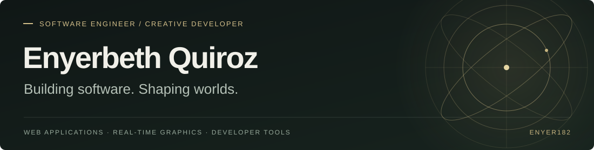
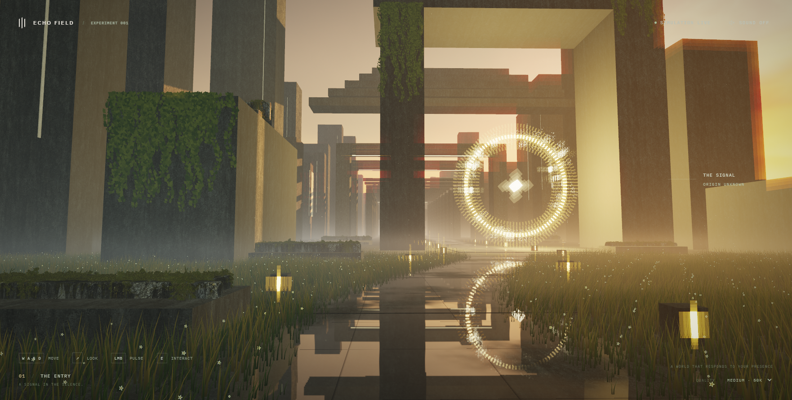

  

I'm **Enyer** (Enyerbeth Quiroz), a full-stack / Python engineer in Buenos Aires. I build backend services and AI systems — **FastAPI**, **RAG**, **agent workflows**, **GCP** — and I've spent a lot of time shipping **Next.js** in production.

Production work has included teams at **Nybble** and **AgileEngine**, on products used at **Indeed** and **Royal Caribbean**.

[LinkedIn](https://www.linkedin.com/in/enyerbeth-quiroz-372b67169/) · [Portfolio](https://tech-with-enyer-portfolio.vercel.app) · [Echo Field](https://echo-field-gamma.vercel.app/)

## Focus

**Backend & AI** — Python, FastAPI, RAG, agentic workflows, prompt engineering, GCP, Docker. I care about retrieval that actually finds the right context, tools that agents can call without mystery failures, and services that stay operable after the demo.

**Web** — Next.js, TypeScript, GraphQL. Same habit as the backend work: clear contracts, readable architecture, something a team can ship and keep.

**Creative** — Three.js, React Three Fiber, WebGPU. [Echo Field](https://echo-field-gamma.vercel.app/) lives here. It's real, and it's secondary to the Python / backend / AI work.

## Selected work

| Project | What it is |
| :--- | :--- |
| **[speech-to-gpt3](https://github.com/Enyer182/speech-to-gpt3)** | AI chat with speech input and image generation against the OpenAI API. |
| **[SQL_to_Google_SpreadSheet](https://github.com/Enyer182/SQL_to_Google_SpreadSheet)** | Python + pandas connector that pulls SQL results into Google Sheets. |
| **[analisis-votaciones-venezuela-2024](https://github.com/Enyer182/analisis-votaciones-venezuela-2024)** | Jupyter notebooks analyzing public 2024 Venezuelan election data for statistical anomalies. |
| **[self-host-n8n-on-gcp](https://github.com/Enyer182/self-host-n8n-on-gcp)** | Terraform + Cloud Run + Cloud SQL setup for self-hosting n8n on GCP. |
| **[codex-unity-mcp](https://github.com/Enyer182/codex-unity-mcp)** | C# / Python MCP bridge so Codex can inspect and drive a live Unity Editor. |
| **[Echo Field](https://echo-field-gamma.vercel.app/)** / **[echosphere](https://github.com/Enyer182/echosphere)** | Browser world and generative audiovisual landscape in Three.js / R3F. Secondary to the backend work. |

## Tools

- **Python & AI:** Python, FastAPI, RAG, agent workflows, prompt engineering, pandas, Jupyter
- **Cloud & ops:** GCP (Cloud Run, Cloud SQL), Docker, Terraform
- **Web:** Next.js, TypeScript, React, GraphQL, Node.js
- **Creative:** Three.js, React Three Fiber, WebGPU, Unity, C#

I like code that stays readable after the first demo, and AI features that fail in obvious, recoverable ways.

---

Open to senior Python, backend, and AI roles. **[LinkedIn](https://www.linkedin.com/in/enyerbeth-quiroz-372b67169/)** · **[Portfolio](https://tech-with-enyer-portfolio.vercel.app)**
